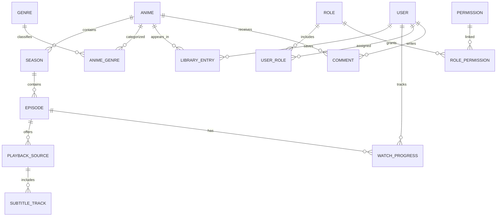

# Entity và quan hệ dữ liệu

Anime, Genre và AnimeGenre đã có model/configuration/migration BE trong feature Anime. Các entity còn lại vẫn là đề xuất để trao đổi FE/BE. Mô hình một anime chứa nhiều mùa/phần vẫn chờ duyệt khi triển khai mùa/tập.

## Danh mục nội dung

| Entity | Trường chính | Ý nghĩa |
| --- | --- | --- |
| Anime | id, slug, title, alternativeTitles, synopsis, posterUrl, bannerUrl, status, format, releaseYear, publicationStatus | Danh mục đã có model BE; publicationStatus nội bộ độc lập trạng thái phát hành |
| Season | id, animeId, number, title, sortOrder | Mùa/phần của anime |
| Episode | id, seasonId, number, title, thumbnailUrl, durationSeconds, publishedAt, status, sortOrder | Tập phim trong một mùa |
| Genre | id, slug, name | Thể loại |
| AnimeGenre | animeId, genreId | Bảng liên kết nhiều anime với nhiều thể loại |
| PlaybackSource | id, episodeId, providerKey, type, label, language, enabled | Nguồn video của một tập |
| SubtitleTrack | id, playbackSourceId, language, label, format, isDefault | Phụ đề gắn với phiên bản video để đúng thời gian |

Quy ước: ID ổn định dùng liên kết; slug phục vụ URL dễ đọc. Không dùng tên phim làm khóa. `sortOrder` hỗ trợ tập đặc biệt; không suy luận tập tiếp theo bằng cách cộng 1 vào ID hoặc số tập.

Giá trị đề xuất:

- Anime.status: `upcoming`, `airing`, `completed`.
- Anime.format: `tv`, `movie`, `ova`, `ona`, `special`.
- Anime.publicationStatus: `draft` (mặc định), `published`; chỉ published được đọc qua common. Đây là mặc định triển khai Anime; không trả trường này trong DTO công khai.
- Episode.status: `draft`, `published`.
- PlaybackSource.type: `mp4`, `hls` trong phạm vi đầu; việc hỗ trợ định dạng cụ thể phải kiểm chứng khi triển khai.

Tập đã xuất bản có thể chưa có nguồn phát khả dụng. FE cần hiển thị rõ, không tự coi trạng thái published là phát được.

## Dữ liệu người dùng

| Entity | Trường chính | Ý nghĩa |
| --- | --- | --- |
| User | id, displayName, avatarUrl, status, createdAt | Tài khoản; DTO công khai chỉ trả trường cần thiết |
| Role | id, code, name | Nhóm quyền, ví dụ member |
| Permission | id, code, description | Quyền hành động, ví dụ comment:create |
| UserRole | userId, roleId | Gán role cho user |
| RolePermission | roleId, permissionId | Gán permission cho role |
| LibraryEntry | userId, animeId, status, isFavorite, updatedAt | Danh sách theo dõi và yêu thích |
| WatchProgress | userId, episodeId, positionSeconds, completed, updatedAt | Tiến độ của từng tập |
| Comment | id, animeId, userId, body, status, createdAt, updatedAt, deletedAt | Bình luận anime, tác giả lấy từ phiên |

Role/Permission là mô hình RBAC đề xuất; guest không phải tài khoản hoặc dòng trong UserRole. `User.status` đề xuất active/blocked; `Comment.status` đề xuất visible/hidden/deleted. Bình luận chưa hỗ trợ reply lồng nhau trong bản đầu. API hồ sơ riêng `/me` tổng hợp roles và permissions từ các quan hệ, không nhận các quyền này do FE tự khai báo. Xem [rules/roles-permissions.md](docs-FE/rules/roles-permissions.md).

`LibraryEntry.status` đề xuất: `plan_to_watch`, `watching`, `completed`, `on_hold`, `dropped`. Yêu thích độc lập với trạng thái xem.

Không đưa mật khẩu/hash vào entity User mà FE nhận. Lưu trữ xác thực phụ thuộc phương án đăng nhập sẽ chọn sau.

## Quan hệ

## Ràng buộc quan trọng

- `Anime.slug` duy nhất; `AnimeGenre` duy nhất theo cặp animeId/genreId.
- Một LibraryEntry cho mỗi cặp userId/animeId; một WatchProgress cho mỗi cặp userId/episodeId.
- Role.code và Permission.code duy nhất; cặp UserRole và RolePermission không trùng. Có permission không bỏ qua ownership hoặc trạng thái tài khoản/tài nguyên.
- Comment.userId do BE lấy từ phiên. Chỉ trả bình luận visible qua common; sửa/xóa phải kiểm tra tác giả, xóa mềm và không tự khôi phục bình luận bị ẩn.
- Thời gian lưu theo UTC dạng ISO 8601, FE hiển thị theo múi giờ phù hợp.
- Tiến độ không âm; kiểm tra với thời lượng nếu đã biết. Hoàn thành tập và quy tắc xem lại cần thống nhất trước khi đồng bộ BE.
- URL phát có thời hạn được cấp khi mở tập, không lưu cố định trong fixture danh mục hoặc lịch sử xem.
- Chưa xóa cứng anime/tập có lịch sử liên quan cho đến khi chốt chính sách lưu trữ.

## Mở rộng sau

Rating/Review, ReleaseSchedule, PlaybackReport và quan hệ franchise có thể thêm khi có yêu cầu. Không hiển thị điểm đánh giá hoặc lượt xem như dữ liệu thật khi chưa có nguồn và cách tính.

Với phim điện ảnh, tạm đề xuất một Season và một Episode để tái sử dụng trình phát. Đây là lựa chọn cần duyệt, không phải yêu cầu bắt buộc.
